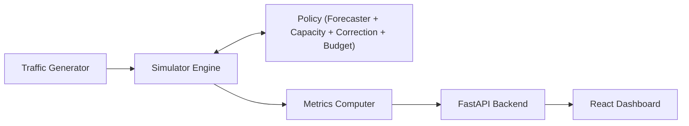

# WarmLambda AI

WarmLambda AI is a discrete-event simulator and interactive dashboard designed to evaluate and compare warm-capacity policies in serverless computing platforms (inspired by AWS Lambda).

It models the full container lifecycle (cold starts, warm idle states, active execution, eviction, and queue timeouts) and benchmarks predictive keep-alive strategies against reactive and static provisioning baselines. Costs are measured in dimensionless simulation units, providing a controlled environment for algorithmic research without cloud provider costs or deployment overheads.

The standard simulation duration is **3600 seconds (1 hour)** and the default
idle timeout is **60 seconds**. API requests shorter than 600 seconds are
rejected unless they explicitly set `allow_short_runs=true` for diagnostics.

> [!NOTE]
> All simulation results, metrics, and capacity levels are simulated estimates under stated theoretical assumptions. They are not real AWS measurements or billing invoices.

---

## Architecture

The system consists of a modular simulation core, an experiment runner, a FastAPI web service, and a React dashboard:



1. **Traffic Generator**: Produces realistic synthetic arrival traces via Non-Homogeneous Poisson Processes (NHPP) using the Lewis-Shedler thinning algorithm.
2. **Simulator Engine**: A discrete-event execution queue that models container concurrency, instance state transitions, cold-start initialization delays, and request timeout drops.
3. **Policy Subsystem**: Implements online warm-capacity algorithms:
   - **Forecaster**: Predicts next-window arrival rates using EWMA or Seasonal Naive estimators without future-data leakage.
   - **Capacity**: Applies Little's Law ($L = \lambda \cdot W$) plus a configurable headroom multiplier.
   - **Correction**: Reactively boosts capacity based on instantaneous queue length and busy instances.
   - **Budget**: Enforces maximum warm instance ceilings.
4. **Metrics Computer**: Calculates cold-start rates, latency percentiles (p50, p95, p99), total weighted instance costs, resource utilization, and drop rates.
5. **FastAPI Backend**: Serves REST endpoints for scenario inspection, policy runs, comparative batch executions, and aggregated summaries.
6. **React Dashboard**: An interactive, accessible web interface built with React, Vite, and Recharts for exploring trade-offs and visualizing time series.

---

## Installation

### Prerequisites
- Python 3.10+
- Node.js 18+ and npm

### 1. Clone the Repository
```bash
git clone https://github.com/your-username/warmlambda.git
cd warmlambda
```

### 2. Set Up Python Environment
```bash
# Create and activate virtual environment
python -m venv .venv

# Windows PowerShell:
.\.venv\Scripts\Activate.ps1

# Linux / macOS:
source .venv/bin/activate

# Install Python dependencies
pip install -r requirements.txt
```

### 3. Set Up Frontend Environment
```bash
cd frontend
npm install
cd ..
```

---

## Running the Project

### 1. Run the Backend API
Start the FastAPI application with `uvicorn`:

```bash
uvicorn api.main:app --host 127.0.0.1 --port 8000 --reload
```

The API will be accessible at `http://localhost:8000`.
- Interactive Swagger docs: [http://localhost:8000/docs](http://localhost:8000/docs)
- Alternative ReDoc docs: [http://localhost:8000/redoc](http://localhost:8000/redoc)

### 2. Run the Frontend Dashboard
In a separate terminal window:

```bash
cd frontend
npm run dev
```

Open [http://localhost:5173](http://localhost:5173) in your browser. The dashboard connects to the local backend at `http://localhost:8000`.

To run design constraint checks and production builds:
```bash
cd frontend
npm run check
npm run build
```

### Production deployment with Docker

The repository includes a production image that builds the dashboard and serves
it from FastAPI. Build and run it from the repository root:

```bash
docker build -t warmlambda .
docker run --rm -p 8000:8000 warmlambda
```

Open [http://localhost:8000](http://localhost:8000). The API health endpoint is
available at [http://localhost:8000/health](http://localhost:8000/health).

For a separately hosted frontend, set `VITE_API_URL` to the public API URL at
frontend build time and set `ALLOWED_ORIGINS` on the API to a comma-separated
list of allowed frontend origins. When the dashboard is served by this image,
same-origin requests are used automatically.

---

## Running Experiments

Run the automated simulation benchmark scripts directly from the repository root:

1. **Preview Traffic Scenarios**:
   Generates a 4-panel visual preview of all synthetic workloads:
   ```bash
   python -m experiments.preview_traffic
   ```
   Output: `results/traffic_preview.png`.

2. **Evaluate Traffic Forecasters**:
   Benchmarks EWMA and Seasonal Naive estimators against arrival history:
   ```bash
   python -m experiments.eval_forecasters
   ```
   Output: `results/forecast_eval.csv`.

3. **Train machine-learning forecasters**:
   Builds a cached 288,000-row randomized dataset, trains HGB and (when
   TensorFlow is installed) GRU models using seed-group validation:
   ```bash
   python -m experiments.train_forecasters
   ```
   Models and metadata are written to `models/`.

4. **Run Baseline Policies**:
   Evaluates No-Warming, Fixed-Warming ($n \in \{1, 2, 5, 10, 20\}$), Reactive, and Oracle policies:
   ```bash
   python -m experiments.run_baselines
   ```
   Output: `results/baselines.csv`.

5. **Diagnose policy separation**:
   ```bash
   python -m experiments.diagnose
   ```
   Prints the first 20 policy targets, ready/busy snapshots, instance
   creation sources, and cold starts for moderate and high-load traces.

6. **Run the policy ablation**:
   ```bash
   python -m experiments.run_ablation
   ```
   Prints mean cold-start rate, p95 latency, and total cost for moderate,
   high-load, extreme, and periodic scenarios.

7. **Run WarmLambda Forecast Policies**:
   Evaluates WarmLambda across headroom levels (0.2, 0.5, 1.0) and combines with baseline results:
   ```bash
   python -m experiments.run_forecast_policy
   ```
   Output: `results/forecast_policy.csv` and updated `results/final_metrics.csv`.

---

## Running Tests

Run the complete test suite with `pytest`:

```bash
pytest
```

The test suite validates:
- Hand-computed latency calculations for cold starts and warm instance reuse.
- Request conservation and instance-time non-negativity.
- Monotonic decrease of cold starts under increasing fixed warming.
- Causal isolation and proof of zero future-data leakage in policy decisions.
- Deterministic trace generation across seeds.
- FastAPI endpoint schemas, CORS headers, and error handling.

---

## Folder Structure

```
warmlambda/
├── api/                       # FastAPI web backend
│   ├── main.py                # REST endpoints, CORS, exception handlers
│   ├── schemas.py             # Pydantic request and response schemas
│   └── services.py            # Simulation runner, downsampling, summary aggregation
├── docs/                      # Technical documentation
│   ├── ASSUMPTIONS.md         # Simulation parameters, defaults, and scenario mappings
│   ├── LIMITATIONS.md         # Differences from real AWS Lambda and explicit non-claims
│   ├── REPORT_OUTLINE.md      # Research report outline and figure placements
│   └── VALIDATION.md          # Test suite proofs, hand-computed cases, and correctness
├── experiments/               # Runnable benchmark and evaluation scripts
│   ├── eval_forecasters.py    # Time-series forecaster evaluation
│   ├── preview_traffic.py     # Traffic scenario generation and plotting
│   ├── run_baselines.py       # Baseline policy benchmarking
│   └── run_forecast_policy.py # WarmLambda policy parameter sweep
├── frontend/                  # React dashboard application
│   ├── public/                # Static assets and favicon.svg
│   ├── scripts/               # Constraint checker (check.mjs)
│   ├── src/
│   │   ├── pages/             # Dashboard, ExperimentSummary, Privacy, Terms, NotFound
│   │   ├── App.jsx            # Layout, routing, navigation, and disclaimer banner
│   │   ├── config.js          # Client configuration
│   │   └── index.css          # Design system stylesheet
│   ├── index.html             # Application entrypoint
│   └── package.json           # Frontend dependencies and scripts
├── results/                   # Simulation outputs and figures (CSV and PNG)
│   ├── figures/               # Presentation and report figures
│   ├── baselines.csv          # Baseline benchmark records
│   ├── final_metrics.csv      # Unified 220-row experimental benchmark dataset
│   ├── forecast_eval.csv      # Forecaster MAE and sMAPE evaluation
│   ├── forecast_policy.csv    # WarmLambda headroom sweep records
│   └── traffic_preview.png    # 4-panel workload arrival visualization
├── tests/                     # Unit and integration test suite (157 tests)
│   ├── test_api.py            # API routes, payload validation, status codes
│   ├── test_config.py         # SimConfig domain constraints and validation
│   ├── test_forecaster.py     # EWMA and seasonal prediction correctness
│   ├── test_metrics.py        # Cost calculations and percentile calculations
│   ├── test_no_future_leak.py # Formal proof of causal temporal isolation
│   ├── test_policies.py       # Fixed, reactive, and oracle policy logic
│   ├── test_simulator.py      # Discrete-event engine and queue state transitions
│   └── test_traffic.py        # NHPP thinning algorithm and reproducibility
├── warmlambda/                # Core Python package
│   └── core/
│       ├── capacity.py        # Little's Law capacity mapping
│       ├── config.py          # SimConfig immutable configuration dataclass
│       ├── forecaster.py      # EWMA, Holt's linear, and Seasonal Naive models
│       ├── metrics.py         # Summary metrics computation
│       ├── simulator.py       # Discrete-event simulation engine
│       ├── traffic.py         # Thinning NHPP traffic generators and scenarios
│       └── policies/          # Policy implementations
├── LAUNCH.md                  # Pre-launch verification checklist
├── pytest.ini                 # Pytest configuration
├── requirements.txt           # Python dependency specifications
└── README.md                  # Project overview and instructions
```
Thanks for reviewing my Project !!!!!!